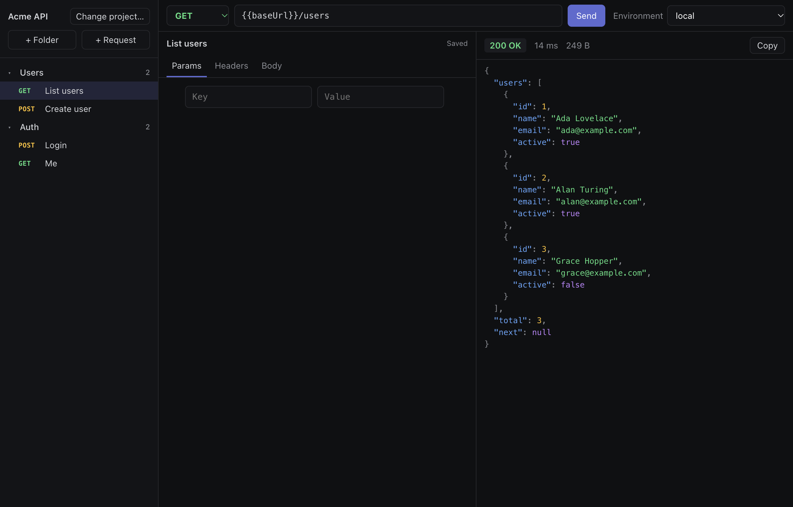

# Requestly

A desktop HTTP client in the spirit of Postman and Insomnia, built with Electron, React and TypeScript. Projects are plain folders of JSON files on your disk: no account, no cloud, no database, and everything can be versioned with git.



The interface is in English and uses a dark theme.

## Quick start

```bash
npm install
npm start
```

`npm start` builds the app with electron-vite and launches Electron. Electron 45 bundles its own Node, so Node is only needed to run npm and the build tools. The project declares no `engines` field; it was developed and tested with Node 26.5.0 and npm 11.17.0 on macOS. Windows has not been tested yet.

On first launch, create a project (you pick the parent folder and a sub-folder named after the project is created) or open an existing one (a folder that contains `workspace.json`). The last project is reopened automatically on the next launch, and the "Change project…" button in the sidebar returns to this screen.

## Features

- **Projects** — one project is one folder you choose; the recent projects list is remembered.
- **Sidebar tree** — project, folders, requests, with the HTTP method colour-coded. Create, rename, delete, and drag and drop to move or reorder requests between folders.
- **Request editor** — method, URL, query params, headers and a JSON or plain-text body. Params and headers are key/value tables with a checkbox to enable or disable each row.
- **Autosave** — edits are written to disk shortly after you stop typing and again when the window is closed or the app is quit (Cmd+Q); a request whose save failed is marked with a dot and retried. Quitting waits for a save that is already running, and reloading the window (the error screen's Reload button) keeps the last edit, except one whose save failed: that edit is marked "not saved" in the sidebar and lives only in memory, so a reload loses it.
- **Response** — status (coloured), duration, size, and the body. JSON is pretty-printed and shown progressively, so large responses stay fluid. Bodies are capped at 5 MiB.
- **Environments** — several per project (for example `local`, `prod`) with key/value variables and a selector in the top bar. `{{name}}` is replaced in the URL, params, headers and body when the request is sent. Undefined variables are reported in a banner above the response.
- **Resilient loading** — a corrupt request, environment or `workspace.json` does not stop a project from opening, and request files with missing fields are filled with defaults; the sidebar shows a dismissible "N files ignored" banner listing the files and the parse errors.

### Keyboard shortcuts

| Keys | Where | Action |
| --- | --- | --- |
| Cmd/Ctrl+Enter | Request area | Send the request |
| Enter | URL field | Send the request |
| Arrow Up / Down | Sidebar tree | Move between folders and requests |
| Arrow Left / Right | Sidebar tree | Collapse or expand a folder; Left on a request jumps to its folder |
| Enter | Sidebar tree | Open a request, or toggle a folder |
| F2 | Sidebar tree | Rename the selected request or folder |
| Delete / Backspace | Sidebar tree | Delete (asks for confirmation) |
| Context menu key, Shift+F10 | Sidebar tree | Open the rename/delete menu |
| Escape | Dialogs and rename fields | Cancel |

## Where your data lives

A project is a folder with this layout:

```
my-project/
├── workspace.json          # project name, order of folders and requests, active environment
├── Users/                  # one sub-folder per folder in the sidebar
│   ├── List users.json     # one file per request
│   └── Create user.json
└── environments/
    └── local.json          # one file per environment
```

File names are derived from the names you type: characters that are invalid in file names are replaced by `-`, Windows reserved names (`CON`, `NUL`, …) get a `-` suffix, names are capped at 200 bytes, and clashes get a ` 2`, ` 3` suffix. The real request name is stored inside the JSON file.

## Scripts

| Command | What it does |
| --- | --- |
| `npm start` | Build, then launch the app |
| `npm run dev` | electron-vite dev server with hot reload (checked: the strict Content-Security-Policy does not break it) |
| `npm run build` | Production build into `out/` |
| `npm test` | Run the Vitest unit tests |
| `npm run typecheck` | Type-check with `tsc --noEmit` |

## Tech stack

Electron 45, React 19, TypeScript 7, electron-vite 6 (Vite 8), Vitest 5. The only runtime dependencies are `react` and `react-dom`; the styling is hand-written CSS with no UI library.

TypeScript 7 (the native compiler, still invoked as `tsc`) is used only for type checking (`tsc --noEmit`). The code is transpiled by Vite and esbuild, which do not depend on the TypeScript compiler.

The production renderer bundle is about 626 KB of JavaScript (mostly React) and 13 KB of CSS.

## Licence

MIT, see [LICENSE](LICENSE).

## Documentation

[docs/ARCHITECTURE.md](docs/ARCHITECTURE.md) explains how the app works: processes, storage format, state, autosave, the send flow, JSON rendering, testing and known limitations.

## Roadmap

- **OpenAPI / Swagger import (v2)** — create folders by tag, prefilled requests and a `baseUrl` environment from a spec. Creating requests by hand stays possible.
- Not planned for v1 and not built: light theme, tabs for open requests, response headers, request history, dedicated authentication helpers (add headers by hand).
