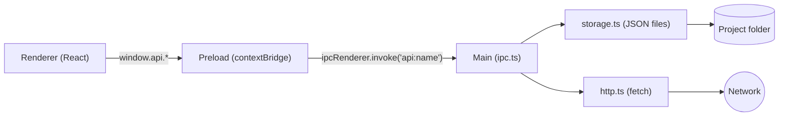

# Architecture

Nudge is an Electron app with three code areas that map to Electron's three contexts:

```
src/main/      Node.js main process: filesystem, HTTP, dialogs, IPC handlers
src/preload/   preload script: exposes a fixed `window.api` to the page
src/renderer/  React UI (sandboxed page, no Node access)
src/shared/    pure TypeScript used by both sides: types, the Api contract, URL/variable/file-name helpers
```



## Processes

- **Main** (`index.ts`) creates one `BrowserWindow` (hidden until `ready-to-show`, dark `backgroundColor`, `contextIsolation` and `sandbox` on) and registers the IPC handlers (`ipc.ts`). The window may only reload the page it already shows: `will-navigate`, `will-frame-navigate` and `will-redirect` go through `isAllowedNavigation` (`navigation.ts`), which allows a target equal to the current URL (hash ignored) and blocks everything else. Other windows and webviews are denied, so a file dropped from Finder cannot replace the UI; the renderer also ignores file drops. Electron fires `will-navigate` for `location.reload()`, so a blanket block would also kill the error screen's Reload button and Vite's full reloads. After a reload the renderer starts from scratch (project closed, then `reopenLast`, which reopens the most recent project even if the user was on the Welcome screen before the reload); main keeps its open-project root and the per-window close gate, and the new page re-registers `onBeforeClose`. `requestSingleInstanceLock` makes a second launch focus the first window.
- **Closing saves first.** The window's `close` event is intercepted by a small gate (`closeGate.ts`): the first request is prevented and the renderer gets `app:before-close`; the renderer flushes the autosaver (which also waits for a save already running, since the file write is not atomic) and the environment editor's pending save, then calls `readyToClose`, and main closes for real. If the page has no `onBeforeClose` listener (error screen, still loading), the preload answers `readyToClose` itself at once. A 3 s timeout lets a stuck renderer quit anyway. Cmd+Q goes through the same path: `before-quit` sets a flag and the window's `closed` event finishes the quit.
- **Preload** (`preload/index.ts`) builds `window.api` from an exhaustive record of method names (every `Api` key except `onBeforeClose`), each forwarding to `ipcRenderer.invoke('api:<name>', ...args)`, plus the `onBeforeClose` subscription (`shared/beforeClose.ts`). The renderer never sees `ipcRenderer` or Node.
- **Renderer** talks only to `window.api`, whose type is `Api` in `shared/api.ts`. The page has a Content-Security-Policy (`default-src 'self'`).

HTTP requests are sent from the main process with Node's `fetch`, not from the page. This avoids the browser's CORS restrictions, which would otherwise block most APIs.

## IPC surface

Defined once in `shared/api.ts`:

- Workspace: `pickFolder`, `openWorkspace`, `createWorkspace`, `getRecents`, `reopenLast`, `loadWorkspace`.
- Window: `onBeforeClose` (one listener, returns an unsubscribe) and `readyToClose`.
- Folders and requests: `createFolder`, `renameFolder`, `deleteFolder`, `moveFolder`, `createRequest`, `saveRequest`, `renameRequest`, `deleteRequest`, `moveRequest`.
- Environments: `saveEnvironment`, `deleteEnvironment`, `setActiveEnvironment`.
- HTTP: `send`, `cancel`, `missingVariables`.

Only opening a project takes a path: `openWorkspace(root)` and `createWorkspace(parent, name)` receive one that came from the folder dialog (`pickFolder`) or the recents list. Main then keeps the open project root in memory and prefixes it to every other storage call, which never receive a path; a storage call before a project is open fails with "No project is open".

- **Open** requires `<root>/workspace.json` to exist (a corrupt one still opens, with a warning); any other folder is refused and nothing changes.
- **Create** takes a *parent* folder and creates `<parent>/<safe project name>` there. It refuses a target that already contains `workspace.json` or is a non-empty folder, so an existing project or folder is never overwritten.
- **Switching project**: the sidebar's "Change project…" button flushes the autosaver, then decides whether anything is still unsaved (it reads the `unsaved` map after the flush, through a ref, so an edit the flush just saved does not trigger a prompt), cancels the autosaver (so no timer can write one project's draft into another), and dispatches `closed`; the welcome screen then shows create / open / recents again. If an edit could not be saved the user is asked to confirm first. While it runs the button is `aria-disabled` (not `disabled`, so it keeps keyboard focus) and reads "Switching…" (`aria-busy`), so a second click cannot start another switch.

All storage calls, including `openWorkspace`, run through **a single promise queue** (`queue.ts`). Disk mutations therefore never interleave, and each one reads the index fresh. `send`, `cancel`, `missingVariables` and `getRecents` are outside the queue, so a slow request never blocks saving; `addRecent` runs inside the queued `open()`.

## Storage format and invariants

```
<project>/workspace.json         { name, folderOrder, requestOrder: { <dir>: [<file>...] }, activeEnvironment }
<project>/<Folder>/<Name>.json   { name, method, url, params[], headers[], bodyType, body }
<project>/environments/<Name>.json   { name, variables: [{ key, value, enabled }] }
```

- **The disk is the truth for what exists; the index only gives order.** Loading lists the folders and `.json` files on disk and orders them with `merge()`: entries named in the index come first in index order (stale entries are dropped), files unknown to the index are appended sorted by name. A project edited by hand or by git still loads.
- **Invalid files are skipped, not fatal.** A JSON parse error, a request without a string `name`, or a corrupt `workspace.json` becomes a string in `WorkspaceTree.warnings`; load continues (a corrupt index falls back to an empty one). The sidebar shows the warnings in a dismissible banner.
- **Shapes are normalised on load, files are left untouched.** A request file gets `method` upper-cased (else `GET`), string `url`/`body`, `params`/`headers` as arrays of well-formed rows (malformed rows dropped), `bodyType` in `none|json|text`; environment variables are filtered the same way. A hand-edited file missing fields therefore loads instead of crashing the UI.
- **Index fields are validated, and names are never object keys of a normal object.** `folderOrder` must be an array of strings and each `requestOrder` entry too, else it is ignored. `requestOrder` is a null-prototype object, so folders named `__proto__`, `constructor` or `toString` work. Renderer maps (`unsaved`) are keyed by `dir/file`, which always contains a `/`.
- **Validate first, then touch the disk.** The structural mutators (create, rename, delete, move of folders and requests, `deleteEnvironment`, `setActiveEnvironment`) read the index before changing files, so an unreadable index leaves the disk untouched; `renameFolder` and `deleteFolder` also check that the folder is listed on disk, and `deleteFolder` only removes a folder that is not reserved. `saveRequest` and `saveEnvironment` do not read the index.
- **Guards.** Arguments from the renderer must be plain names: no `/`, `\`, `..`, NUL; request files must end in `.json`; folder names cannot start with `.` or be `environments` or `workspace.json`. `createFolder` and `renameFolder` strip leading dots and avoid the reserved names.
- **File names** come from `safeFileName`: forbidden characters become `-`, Windows reserved names (`CON`, `NUL`, `COM1`…) get a `-` before the first dot, trailing dots and spaces are removed, an empty name becomes `untitled`, the length is capped at 200 bytes, and clashes (case-insensitive) get ` 2`, ` 3`…
- **Atomic index write.** `workspace.json` is written to `workspace.json.tmp` and renamed over the target.
- **`saveRequest` never creates a file.** It checks the target exists and otherwise throws `request-missing`. A late autosave therefore cannot resurrect a request that was renamed, moved or deleted in the meantime.
- Renaming or moving a request keeps its place in the index; a rename also rewrites `name` inside the file.
- A mutation made while `workspace.json` is corrupt fails with the parse error (only loading falls back); fix or delete the file to continue.

## Renderer state

`store.ts` holds one reducer exposed through React context:

- `tree` — the last `WorkspaceTree` from main.
- `selected` — `{ dir, file }` of the open request. The request itself is identified by its path.
- `draft` — the editable copy of the selected request; edits go here first.
- `unsaved` — a map of requests whose last save failed (shown as a dot in the sidebar).
- `draftId` — a counter bumped whenever the open request changes identity (selecting another request, or the selection being cleared). A rename that re-points `selected` keeps it. Anything asynchronous captures `draftId` and drops its result if it changed.
- `response`, `sending` — the last result and whether a send is in flight.
- `session` — a counter bumped by `loaded` and `closed`. Async work that ends in `treeRefreshed`, `docSaved` or `select` (sidebar actions, autosave, the environment selector and editor) carries the session it started in; the reducer ignores it if the session has changed, and ignores both actions when no project is open. A late refresh from project A therefore cannot bring back A's tree after it was closed, or replace project B.

Three actions replace the tree: `closed` (back to the welcome screen: same reset, `draftId` bumped), `loaded` (a different project was opened: resets everything) and `treeRefreshed` (same project after a mutation: keeps `draft`, `response` and `unsaved`, re-points `selected` after a rename or move, and clears the selection only if the request no longer exists).

## Autosave

`useAutosave.ts` debounces edits (500 ms) and writes them with `saveRequest`.

- **The target path is resolved when the save runs, not when the edit is made.** The save reads the current `selected`, and only counts it if the draft is still the one the pending edit came from (`ownedSelected`). The document itself carries no path. So a rename or move between the keystroke and the flush saves to the new file, and a stale edit is dropped if another request was opened.
- **`hold` / `flush` / `cancel`.** Sidebar rename, move and delete (not create: `addFolder` and `addRequest` do not hold) call `autosaveCtl.hold()` so no timer fires while the tree is being refreshed and `selected` re-pointed; releasing re-arms any pending edit. `flush` writes immediately and first waits for a save that is already running (saves never overlap; an edit scheduled meanwhile is written right after), so a caller that awaits it knows the file is complete (used before selecting another request, before sending, before switching project and when the window is closing). The `beforeunload` path is different: `flushNow` sends the pending edit's save at once without waiting for a running one, because the awaiting continuation would never run on a reload; main serialises the writes in arrival order. A reload keeps the last edit unless its save failed (that edit is only in memory and is lost); `cancel` drops the pending edit when the selection is cleared.
- **Failures.** A failed save keeps the edit pending, retries after 2 s up to 5 times, and records the request in `unsaved`. Reopening the unsaved request that is still selected re-schedules its draft (see known limitations for the others). Renaming or moving a request with an unsaved edit writes that edit first and aborts the action if the write fails.
- A keystroke right after a sidebar rename would carry the old name, so the saver always writes the current name.

## Send flow

`send.ts` (`createSender`) coordinates the renderer side of a send:

1. **Claim synchronously.** The in-flight claim is taken before the first `await`, so a double click cannot start two sends.
2. Flush a pending autosave (a failure does not block sending), then read the draft and the active environment's variables.
3. Call `missingVariables` in parallel for the banner; it never delays the send.
4. Call `send(doc, variables, requestId)`. Main substitutes variables, builds the URL (`shared/url.ts`: http/https only, params appended), sets a default `content-type` for bodies, and calls `fetch` with a 30 s timeout. The body is read as a stream and cut at 5 MiB (`truncated`); `isJson` is true only for a complete, parseable JSON body.
5. **Cancel and abandon.** `cancel` marks the flight cancelled and aborts it in main through its `requestId`. `abandon` (called when `draftId` changes) also forgets the flight. A result is published only if it belongs to the current flight **and** the same `draftId`; any other result is dropped.

Main returns a `SendResult` that is either a response or an error of kind `invalid-url`, `invalid-header`, `network`, `timeout` or `cancelled`.

## Response rendering

A multi-megabyte body must not freeze the UI, so `json.ts` and `rows.ts` render it lazily:

- **Lossless scanner.** `jsonLines` is a generator that pretty-prints the raw text in one pass and keeps the original literals (keys, strings, numbers). Numbers beyond double precision and escape sequences are therefore shown exactly as sent, which `JSON.parse` plus `JSON.stringify` would not do. It throws `SyntaxError` on invalid input.
- **Row budget.** `createRowSource` pulls lines from the generator on demand and tokenizes each row only when it is first shown. `JsonView` renders 500 rows (`ROW_BUDGET`), then appends 500 more when the user clicks "Show more". A line longer than 2000 characters is split into plain-text rows so one huge line never becomes one huge DOM node. A body that turns out not to be JSON falls back to plain lines.
- **Memoised.** `JsonView` and `ResponsePane` are `memo`, with stable callbacks from `Layout`, so typing in the editor does not re-render an expanded response.
- **Cap.** Main stops reading at 5 MiB and the pane shows "Response truncated at 5 MB".

Measured on the development machine: a 4.0 MiB JSON response shows its first lines about 55 ms after the click, with a worst frame gap around 12 ms.

## Environments

- Variables are `{ key, value, enabled }`. The active environment is stored in `workspace.json`; the selector in the top bar changes it through `setActiveEnvironment`.
- **Substitution** (`shared/variables.ts`): `{{name}}` with optional spaces inside the braces and `name` made of letters, digits, `_`, `.` or `-`. A disabled variable counts as missing. An unknown placeholder is left in the text and reported in the missing list. Substitution is one pass: a value that itself contains `{{x}}` is not expanded again. It applies to the URL, the key and value of enabled params and headers, and the body (when the body type is not `none`).
- **Editor save queue** (`EnvEditor.tsx`, `envs.ts`): variable edits are debounced into `createSaver`, which holds the latest unsaved edit and keeps it if a save fails. Every disk operation from the editor goes through one queue, and structural actions (create, rename, delete, switch) first wait for pending edits and are blocked, with "Retry / Discard changes", if they cannot be saved.
- **Rename** is save-new, delete-old, then re-activate. When the old and new names map to the same file (a case-only change), the old file is deleted first and restored if saving the new one fails; if even the restore fails the user is told how many variables to copy before closing.

## Testing

- **Unit tests (Vitest, `npm test`)** cover the pure and I/O logic: storage against a real temporary directory (order, guards, corrupt files, awkward names), the HTTP sender against a local `http` server, the queue, recents, file names, URL building, substitution, the reducer, the autosaver and its race handling, the sender, the JSON scanner and row source, drag-and-drop index maths, and environment helpers.
- **Reload and quit, checked on the real app** (remote debugging plus `--inspect`): before the fix `location.reload()` left a `window.__marker` in place (blocked); after it the marker is gone and `Page.frameNavigated`/`load` fire, while `location.href = 'file:///etc/hosts'`, `location.assign('https://example.com')` and `window.open` stay blocked. The error screen's Reload button brings the app back and `reopenLast` reopens the project; an edit made just before a reload is saved by the `beforeunload` flush. Quit was exercised without keyboard automation through `Menu.sendActionToFirstResponder('terminate:')` from the main-process inspector, which is what the Quit menu item (Cmd+Q) does on macOS: the process exits in about 0.3 s from the Welcome and error screens, and an edit made under 300 ms earlier is on disk. With the project write artificially slowed to 1.5 s in a throwaway copy, a quit during a running save lost the edit before the fix and kept it after. A physical Cmd+Q keystroke was not tested.
- **By hand through the Chrome DevTools Protocol** (the Electron window was driven with remote debugging): the sidebar, drag and drop, autosave, the response pane for each result kind, large responses, environments, startup time. This was done during development and again for the final measurements.
- **Type checking:** `npm run typecheck` (`tsc --noEmit`, TypeScript 7). Vite and esbuild do the transpiling.

## Known limitations

- A header whose name or value is not valid after substitution (for example an undefined `{{variable}}`) is reported as "Invalid header" with its name. The `Host` header cannot be overridden: `fetch` treats it as forbidden.
- An unsaved edit of a request that is not the selected one lives only in `tree`; the next tree refresh replaces it with the disk version while the unsaved dot stays.
- Renaming a folder while it contains unsaved requests that are not the open one drops their in-memory edits and unsaved markers.
- Mutations fail while `workspace.json` is corrupt; only loading is tolerant (the disk is left untouched).
- There are no component (DOM) tests: UI behaviour is covered by tests of the extracted logic plus manual runs.
- Real mouse drag and drop was only exercised with synthetic drag events.
- Windows has not been tested; file-name rules follow its restrictions but have only been run on macOS.
- File-name rules do not normalise Unicode (NFC/NFD).
- The sidebar context menu has no arrow-key navigation.
- A response truncated at 5 MiB may end in a replacement character if the cut falls inside a UTF-8 sequence.
